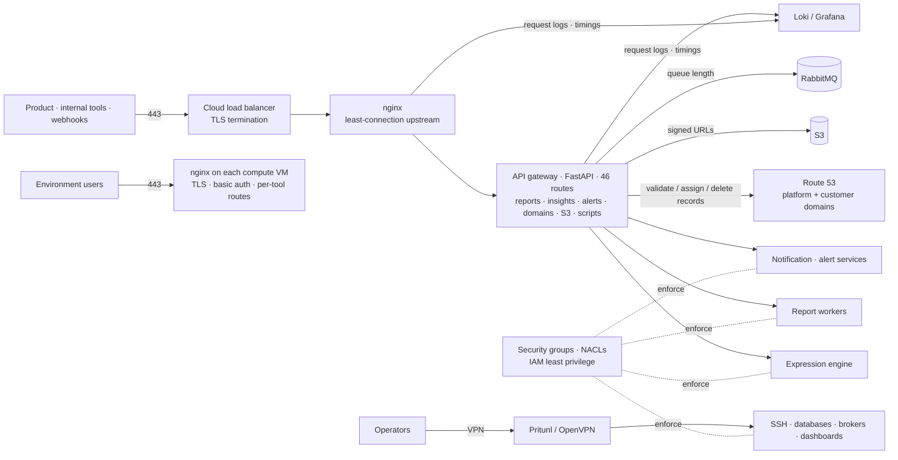

# Secure Service Exposure & Network Access

 -lightgrey) 

> **Architecture write-up.** This documents a system I designed and built as a DevOps Engineer at Faclon Labs (Mumbai). The implementation belongs to my employer and is not published; what follows is the design, the moving parts and the outcomes, with internal names and details left out.

One front door for the data-science platform: the cloud load balancer
terminates HTTPS, nginx balances across replicas of an **API gateway**
(FastAPI, **46 routes** across 14 modules) that is the only thing the product
and other teams call, and the gateway talks to the internal services. Compute
environments get their own edge — nginx with TLS and credentials on each VM —
and their DNS lifecycle, including customer-owned domains, runs through the
gateway. Operators reach anything else over Pritunl / OpenVPN; IAM and network
controls close the direct paths.

## The problem

Services had grown up each with its own port, its own (or no) TLS and its own
idea of authentication. Security groups accumulated exceptions. Giving someone
access meant touching several machines, and every new integration wanted a
direct line to some internal service.

## Architecture

## How access works

- **One front door.** Everything public goes through the load balancer, nginx
  and the gateway; services behind it listen only to the gateway. HTTPS
  termination moved from the nginx ingress to the cloud load balancer.
- **The gateway is the contract.** Reports, insights, alerting, domain
  lifecycle, signed uploads and the queue-length signal for autoscaling are
  routes on it, with CORS and origin allow-lists per surface, request-level
  logging and a health endpoint. Other teams integrate against it, never
  against internal services or cloud credentials.
- **Domains as an API.** Validate, assign and delete DNS records for
  platform subdomains and customer-owned domains (hosted zone resolved per
  domain), so the UI and the provisioner never touch Route 53 directly.
- **Per-environment edge.** Every compute VM runs nginx with its own TLS and
  basic-auth credentials and one location per installed tool, issued at
  provisioning time; certificate renewal is automated.
- **Private by default.** Service ports are closed to the world; only the
  gateway tier and the VPN range can reach them. Administrative access (SSH,
  databases, brokers) is VPN-only, with onboarding, access control and
  offboarding owned in one place.
- **IAM hardening**: least-privilege roles for services and people.

## Outcomes

- Direct service exposure eliminated; everything behind HTTPS on 443.
- One gateway (46 routes) as the integration surface for the product and
  other teams.
- Centralised access management and audit (gateway and proxy logs in Loki).
- Fewer security-group exceptions, consistent TLS everywhere.

## Stack

Cloud load balancer (ALB) · Nginx · FastAPI · Route 53 · S3 · Pritunl · OpenVPN · AWS security groups and NACLs · IAM · Loki / Grafana

## My role

Designed and implemented the proxy and gateway layer (the domain lifecycle,
S3, alerting and queue-length routes are mine), the per-environment edge, the
VPN infrastructure and the IAM / network-security controls.
