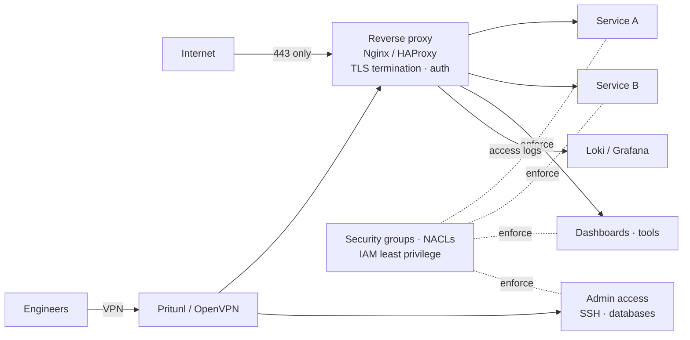

# Secure Service Exposure & Network Access

 -lightgrey) 

> **Architecture write-up.** This documents a system I designed and built as a DevOps Engineer at Faclon Labs (Mumbai). The implementation belongs to my employer and is not published; what follows is the design, the moving parts and the outcomes, with internal names and details left out.

A central reverse-proxy and access layer: every internal service is reached
over HTTPS on port 443 through Nginx / HAProxy with authentication in front,
operators and developers connect through Pritunl / OpenVPN, and IAM and
network controls close the direct paths. Direct exposure of services ended;
access is managed in one place.

## The problem

Services had grown up each with its own port, its own (or no) TLS and its own
idea of authentication. Security groups accumulated exceptions. Giving someone
access meant touching several machines.

## Architecture

## How access works

- **One front door.** Public and internal web services are published as
  routes on the proxy; TLS certificates are issued and renewed centrally
  (renewal automated in Python with Route 53).
- **Authentication at the edge** for tools that have none of their own.
- **Private by default.** Service ports are closed to the world; only the
  proxy and the VPN range can reach them. Administrative access (SSH,
  databases) is VPN-only.
- **VPN lifecycle as a process**: onboarding, access control, offboarding and
  documentation owned in one place.
- **IAM hardening**: least-privilege roles for services and people.

## Outcomes

- Direct service exposure eliminated; everything behind HTTPS on 443.
- Centralised access management and audit (proxy access logs in Loki).
- Fewer security-group exceptions, consistent TLS everywhere.

## Stack

Nginx · HAProxy · TLS / Route 53 · Pritunl · OpenVPN · AWS security groups and NACLs · IAM · Loki / Grafana

## My role

Designed and implemented the proxy and access layer, owned the VPN
infrastructure and the IAM / network-security controls.
